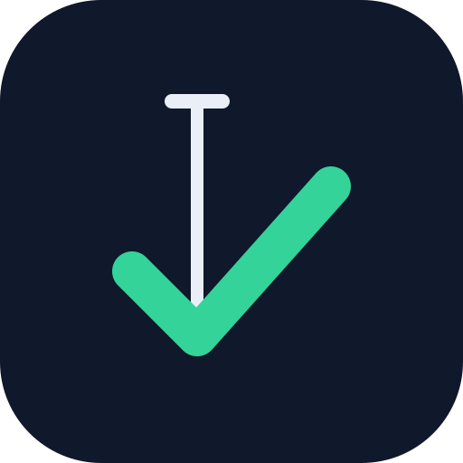

<p align="center">
  
</p>

<h1 align="center">Plumbline</h1>

<p align="center">
  <strong>Your dev team, inside Claude Code.</strong><br>
  Product, lead, senior engineers, security and QA: an autonomous agent team that turns one
  request into a reviewed, tested, documented pull request.
</p>

<p align="center">
  
  
  
  
  
</p>

<p align="center">
  <a href="#-quick-start-60-seconds">Quick start</a> ·
  <a href="#-how-to-use-it">How to use it</a> ·
  <a href="#-meet-your-team">The team</a> ·
  <a href="#-how-it-works">How it works</a> ·
  <a href="#-quality-gates-that-cant-be-talked-past">Quality gates</a> ·
  <a href="#-security-by-attack-plan">Security</a> ·
  <a href="#-works-with-your-stack">Your stack</a> ·
  <a href="#-proof-not-promises">Proof</a>
</p>

<p align="center">
  
</p>
<p align="center"><sub>A feature build, start to finish (sped up). <a href="docs/assets/plumbline-team.mp4">Watch the full film (MP4, 100 s)</a>.</sub></p>

---

## ⚡ Why builders use it

AI agents write code fast. Left alone they also **guess requirements, skip edge cases,
overwrite each other's files, delete the failing test and declare victory.** Plumbline
replaces "trust me" with a process: spec-driven, test-first, and enforced by
deterministic hooks, not by the model's say-so.

| You, without Plumbline | You, with Plumbline |
| --- | --- |
| Write a long prompt, hope it understood | Say what you want. **Product asks the questions** that matter, then writes the spec and acceptance criteria |
| One agent does everything, badly in places | **A team with roles**: product decides *what*, the lead decides *how*, seniors build, QA tests, a reviewer reads the diff |
| "Done" = the agent says so | Done = **typecheck, lint and the tests named after each criterion pass**, checked by a hook |
| Parallel agents trample each other | **Least-privilege file ownership**: an engineer can only edit the files it owns |
| Security is an afterthought | **Red-team by design**: the lead plans the attacks, engineers write them as failing tests first, risky work gets an independent attack round |
| Context is lost between sessions | **Persistent project memory** and living docs: spec, decisions, change log, a roadmap |
| You review a mystery diff | You get a **PR with every gate passed** and a paper trail. You merge |

## 🚀 Quick start (60 seconds)

```bash
# 1. Install the plugin into your project
claude plugin marketplace add safiullah7/plumbline
claude plugin install plumbline@plumbline --scope project

# 2. Start Claude Code (agent teams are only needed for Full-size work)
CLAUDE_CODE_EXPERIMENTAL_AGENT_TEAMS=1 claude
```

```text
# 3. Ask your team for something
/plumbline:build add CSV export to the invoices page
```

That's it. Plumbline sizes the work, asks only what it must, runs the right process and
ends with a PR. **You stay the decision-maker**: you answer product's questions, approve
the plan once, and merge.

**Needs:** Claude Code (agent teams for Full-size work) · `jq` · Git Bash on Windows ·
your project's typecheck, lint and test commands (Plumbline detects them).

## 🧭 How to use it

You talk to Plumbline with one command, **`/plumbline:build <what you want>`**, in plain
English. The product engineer reads your docs and code, sizes the request and shows you
its decision before anything is created.

### Three sizes, picked for you

| | ⚡ **Quick** | 🧩 **Standard** | 🏗️ **Full** |
| --- | --- | --- | --- |
| **Ask for** | A small change in one place | A feature in an existing module | A new module, auth, billing, migrations, or ~10+ criteria |
| **Example** | `/plumbline:build make the double-booking check ignore cancelled bookings` | `/plumbline:build add CSV export to the invoices page` | `/plumbline:build patient portal: patients sign in and see their own X-rays, treatment plans and invoices` |
| **Who works** | 1 engineer + reviewer | Product, lead, 1-2 engineers, QA | The whole team, in parallel |
| **You do** | Merge the PR | Approve the plan once, merge | Answer the interview, approve the plan, merge |
| **You get** | A branch, tests named after 1-3 criteria, a review, a PR | A feature folder with spec, criteria, plan and test record, plus the PR | Everything, with an agent team and the full quality pipeline |

### What you'll see

Plumbline prints its triage before it touches anything:

```text
Plumbline triage
Size: Full
Module: patient-portal (new)
Surfaces: api; web-ui
Roles: product, lead, 4 engineers, reviewer, QA
Evidence: api: transcripts; web-ui: journeys
Security: independent
Engineers: 4
Team: yes
Why: new sign-in and per-practice patient data (tenancy, sensitive data)
```

Then the product engineer clarifies, like a real PM would (example):

```text
Product › Can a parent see a child's records?
You     › Yes, until 18.
Product › Are some dentist notes private?
You     › Internal notes stay hidden.
Product › How long can an X-ray download link live?
You     › 10 minutes.
```

From there the team runs on its own: spec → plan (you approve) → test-first build →
review → attack round → QA → signoff → **PR #42, ready for your review.**

### More things to ask for

```text
/plumbline:build rate-limit the login endpoint to 5 attempts per minute per IP
/plumbline:build let clinic admins export appointments as CSV for a date range
/plumbline:build add a dark mode toggle to the settings screen
/plumbline:build new billing module: invoices, refunds and Stripe payments
```

### Everyday commands

| Command | Use it to |
| --- | --- |
| `/plumbline:build <request>` | Get anything built: sized, planned, built, tested, PR'd |
| `/plumbline:status` | See where a feature stands: plan, test coverage, bugs, questions, uncommitted work |
| `/plumbline:handoff` | Save progress and get a prompt to resume in a fresh session |
| `/plumbline:signoff` | Run the gap check and open or update the PR |
| `/plumbline:phase-next` | Get the next feature proposed from evidence: missed metrics, shipped bugs, open findings |

<details>
<summary><b>Driving a Full feature by hand</b></summary>

```text
/plumbline:kickoff clinic scheduling    # docs from templates, a branch, the current feature
/plumbline:discover                     # interview → spec.md
…                                       # product, lead, engineers and QA do their parts
/plumbline:status                       # where things stand
/plumbline:signoff                      # gap check → PR (you merge)
/plumbline:phase-next                   # what to build next
```

Flags: `/plumbline:kickoff <module> <feature-slug> [--profile standard|full] [--no-ux] [--security none|attacks|independent]`.
</details>

## 👥 Meet your team

| | Role | What they own | Runs on |
| --- | --- | --- | --- |
| 🧭 | **Product engineer** | *What* gets built: research, clarifying questions, spec, acceptance criteria (`AC-01-004`), user journeys and screen text, decisions | Opus · high effort |
| 🏗️ | **Lead engineer** | *How* it gets built: a step-by-step plan per engineer, contracts, the attack plan, reviews every workstream. **Never writes code** | Opus · high effort |
| 🛠️ | **Senior engineers** | One workstream each: test-first (red → green → refactor), unit + e2e tests, attack tests | Sonnet · effort set by the lead per task |
| 🛡️ | **Security (attack round)** | A senior engineer who didn't write the code tries to break it, logs findings, verifies the fixes | Sonnet · high effort |
| 🔎 | **QA engineer** | Tests the working feature like a real user, files bugs, re-tests fixes | Sonnet · medium effort |
| 🧪 | **Code reviewer** | Fresh-eyes review of every diff: authorization, contracts, tests, performance, security lens | Sonnet, Opus for HIGH work |

**Smart model routing.** Opus where judgement carries the risk, Sonnet where a precise plan
is executed. The lead rates every task LOW, NORMAL or HIGH and sets each engineer's effort
to match, so you don't pay Opus prices for routine work.

**They remember.** Agents keep project memory across sessions, and everything they decide
lands in `docs/product/`: vision, decisions, a change log and each feature's spec, plan and
test record. Your product documents itself as it grows.

## 🔁 How it works


1. **Clarify.** Product researches your docs and code, asks you what it can't decide, and
   writes the spec and observable acceptance criteria. Unanswered questions are escalated,
   never guessed.
2. **Plan.** The lead questions product where the spec is thin, splits the work along
   file-ownership seams, lands shared contracts first and writes each engineer a plan: the
   failing unit test, the e2e test, the change, edge cases and a *done when*. You approve.
3. **Build.** Engineers work test-first in parallel. Hooks enforce ownership and won't let a
   task close until its tests pass.
4. **Review and attack.** The lead reviews each workstream with the code reviewer; comments
   go back and get fixed. For risky work, a security engineer tries to break it.
5. **Test.** QA uses the built feature like a real user, files bugs, and re-tests the fixes.
6. **Ship.** A deterministic gap check runs, the PR opens, docs and memory are updated.
   **You merge.** Plumbline never merges or deploys for you.

## 🔒 Quality gates that can't be talked past

Gates are plain **bash + jq hooks**, not model judgement. They switch on when the plan says
`Status: READY`, so discovery and planning run freely.

| Gate | What it stops | What the agent sees |
| --- | --- | --- |
| **Ownership guard** | Editing another engineer's files | `Ownership guard: eng-a does not own src/b/from-a.txt (owns: src/a/**). Message the owner or the lead.` |
| **Task-created gate** | Work that isn't tied to a criterion | `Task gate: "Untagged task" names no AC IDs.` |
| **Task-completed gate** | "Done" without proof | Runs typecheck, lint and the tests named after the task's IDs; refuses until they pass |
| **Idle gate** | Uncommitted work left behind | Reminds twice, then escalates to the lead |
| **Waiver lock** | An agent lowering its own bar | `Evidence waived:`, `Security waived:` and `Risk accepted:` lines are **user-only** |

Signoff starts with a script that lists every gap. Example output on a feature that isn't
ready:

```text
$ bash scripts/signoff-check.sh
Signoff check: 5 gap(s) in docs/product/clinic/01-scheduling:
- AC-01-004 has no passing test in test-plan.md
- QA verdict is PENDING, not PASS (qa-report.md)
- open bug BUG-01-001 (high): Clinic B's rooms appear in clinic A's list (qa-report.md)
- OPEN question #1: Grey out inactive rooms, or hide them? (questions.md)
- unticked sign-off box: Integration review complete (lead engineer) (signoff.md)
```

<details>
<summary><b>What a teammate is told at start-up</b> (example)</summary>

```text
Plumbline phase: docs/product/clinic/01-scheduling (dev plan: READY).
You are eng-api. You own: apps/api/**
Your brief: docs/product/clinic/01-scheduling/briefs/eng-api.md. Read it before anything else.
Questions in questions.md: 1 open, 0 escalated to the user.
```

Each engineer works from a generated brief: its files, its tasks, only the criteria and
attacks those tasks cite, the business rules, its screens and contracts. Focused context,
fewer tokens, no missed rules.
</details>

## 🛡️ Security by attack plan

Every request gets a `Security:` level at triage, from a rubric about **what the change
does**: authentication, permissions, tenancy, money, sensitive data, public input, AI tool
use, infrastructure.

| Level | What happens | Extra cost |
| --- | --- | --- |
| `none` | Routine work: the reviewer's security checklist | Nothing |
| `attacks` | The lead plans concrete attacks from a catalogue; engineers write each as a **failing test first**; signoff **runs** them and scans the diff for committed secrets | A few hundred tokens for the plan, a handful of tests |
| `independent` | All of the above, plus a **separate attack round**: a different engineer, scoped to the attack surface, tries what the plan missed. Findings are fixed and re-verified | One scoped run, fix rounds only when it finds something |

An attack plan row looks like this:

```text
| SEC ID     | Surface | Attack                                              | Must happen          |
| SEC-01-001 | api     | Patient A swaps in patient B's ID on GET /xrays/:id | 404, nothing leaked |
```

Attack tests can't be faked: signoff runs every `SEC-` test through the same adapters as
the feature's tests. The level can only go up; only you can lower it.

## 🧰 Works with your stack

Plumbline reads what you're building and adapts. Ten **surfaces**: `web-ui`, `mobile-ui`,
`desktop-ui`, `api`, `service`, `cli`, `library`, `data`, `ai`, `infra`. On the first run it
detects your stack from `package.json`, `pyproject.toml`, `go.mod`, `pubspec.yaml` or
`Cargo.toml`, proposes a **project profile**, and you confirm it once.

| Test adapter | Runs |
| --- | --- |
| `node` | node:test, jest or vitest |
| `pytest` | pytest, selected by the criterion ID |
| `go` | `go test -run` on names like `TestAC_01_001` |
| `playwright` | Playwright e2e tests, retries off |
| `generic` | Any command you write in the profile (Rust, .NET, Gradle, Flutter, Swift…) |

Join two adapters with `+` (`node --dir web + playwright --dir web`) to run unit and e2e
tests together. Every adapter prints one line per ID (`pass`, `fail` or `missing`), so a
runner that matches nothing can't pass.

<details>
<summary><b>The project profile (<code>docs/product/project.md</code>)</b></summary>

```markdown
# Project profile

Confirmed by: Safi on 2026-10-25. Edit it when the product changes shape.
Confirm: auto
Multi-tenant: yes
Sensitive data: patient records

## Surfaces
| Surface | Stack | Paths | Run | Typecheck | Lint | AC tests |
| --- | --- | --- | --- | --- | --- | --- |
| web-ui | React, Vite | frontend/** | npm --prefix frontend run dev | npm --prefix frontend run -s typecheck | npm --prefix frontend run -s lint | node --dir frontend + playwright --dir frontend |
| api | Express, TypeScript | backend/** | npm --prefix backend run dev | npm --prefix backend run -s typecheck | npm --prefix backend run -s lint | node --dir backend |
```

Each surface has one kind of evidence QA must record (web-ui `journeys`, api `transcripts`,
cli `golden-output`, ai `eval-set`…), and signoff checks it.
</details>

<details>
<summary><b>What a feature looks like on disk</b></summary>

```text
docs/product/patient-portal/
├── vision.md               who it's for, the problem, principles, the roadmap
├── decisions.md            decisions later features must respect
├── changes.md              one row per Quick change
└── 01-own-records/
    ├── spec.md             goal, research, rules, permissions, non-goals, metrics
    ├── acceptance-criteria.md   AC-01-001 … observable and prioritised
    ├── ux.md               journeys and a text description of each screen
    ├── dev-plan.md         team, ownership, contracts, tasks, attack plan, Status: READY
    ├── security.md         attack results and findings (when the level needs it)
    ├── test-plan.md        QA's functional test record
    ├── qa-report.md        verdict, bugs, evidence
    ├── questions.md        every question and answer
    └── signoff.md          verification and success metrics
```
</details>

<details>
<summary><b>Configuration</b></summary>

| Setting | Default | Purpose |
| --- | --- | --- |
| `PLUMBLINE_TYPECHECK` | `npm run -s typecheck` | Typecheck command for the task gate (`""` skips it) |
| `PLUMBLINE_LINT` | `npm run -s lint` | Lint command for the task gate |
| `PLUMBLINE_TEST_AC` | `npm run -s test:ac --` | Runs the tests for given IDs (when set, it overrides the profile's AC tests cell) |
| `PLUMBLINE_CONFIRM` | `auto` | `always` confirms every triage |
| `PLUMBLINE_HOOK_DEBUG` | off | Log every hook payload to `$TMPDIR/plumbline-hooks.jsonl` |

Set them in the `env` block of `.claude/settings.json`.
</details>

## 📊 Proof, not promises

- **Evals.** Every release runs Claude Code's plugin eval suite (realistic cases per role
  and skill, 3 runs each) against the previous release's scores, and ships only with **no
  regressions**. v0.5: 29 cases, every rerun at or above its v0.4b score, eight new
  security cases at 0.92–1.00. Reports, including the costs, are in [`docs/evals/`](docs/evals).
- **1,846 self-tests** (`bash tests/run-all.sh`): hooks, gates, kickoff, signoff, project
  detection, the security rules, and every test adapter run against the real node:test,
  jest, vitest, pytest, Go and Playwright runners.
- **Independent reviews** of every release's diff before it merges; each finding is fixed
  with a test.

## 🗺️ Roadmap

| Release | Highlights |
| --- | --- |
| ✅ **v0.1–v0.3** | The agent team, ownership and task gates, kickoff and signoff, briefs, product memory, the eval suite (0.84 → 1.00) |
| ✅ **v0.4a** | One `/plumbline:build`: work sized as Quick, Standard or Full, docs by module and feature |
| ✅ **v0.4b** | Project profile, ten surfaces, test adapters, lean roles (product writes the UI text, one QA agent, TDD with unit and e2e), model routing by complexity |
| ✅ **v0.5** | Security by attack plan: triage levels, the lead's attack catalogue, attacks as tests first, independent attack rounds, signoff runs the attack tests and a secrets scan |

Dev plans for each release are in [`docs/`](docs).

## 🧑‍💻 Contributing

```bash
bash tests/run-all.sh                                   # every self-test suite
claude plugin validate ./plugins/plumbline --strict     # plugin validation
claude plugin eval ./plugins/plumbline --scaffold --allow-tools Write Edit --ablation none --no-publish
```

```text
.claude-plugin/marketplace.json   marketplace entry
plugins/plumbline/
├── agents/     the roles
├── skills/     build, kickoff, discover, status, handoff, signoff, phase-next (+ templates)
├── hooks/      gates and context injection
├── scripts/    the gates and tools (bash + jq)
└── evals/      eval cases and fixtures
tests/          self-tests, the live smoke test, the end-to-end benchmark
docs/           dev plans, eval reports, assets
```

## License

[MIT](LICENSE) © 2026 Safi Ullah
