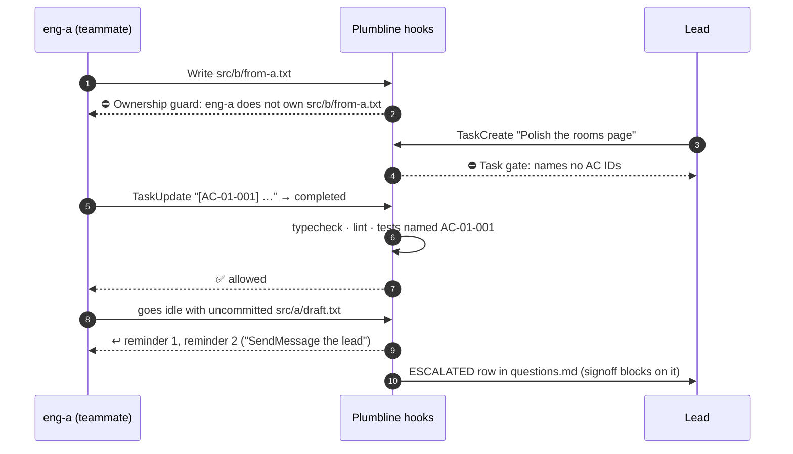

<p align="center">
  
</p>

<h1 align="center">Plumbline</h1>

<p align="center">
  <strong>Ship software feature by feature with a Claude Code agent team,<br>
  and hold every feature against its spec before it merges.</strong>
</p>

<p align="center">
  
  
  
  
  
  
</p>

<p align="center">
  <a href="#size-the-work">Quick, Standard, Full</a> ·
  <a href="#works-with">Works with</a> ·
  <a href="#how-it-works-full">How it works</a> ·
  <a href="#the-team">The team</a> ·
  <a href="#quality-gates">Quality gates</a> ·
  <a href="#proof-not-promises">Proof</a> ·
  <a href="#quick-start">Quick start</a> ·
  <a href="#roadmap">Roadmap</a>
</p>

---

> A plumb line is the builder's oldest instrument: a weight on a string that shows true
> vertical, so nothing gets built crooked. **Plumbline does that for software built by AI
> agents.** Each feature is specified, planned, built and verified by a small team
> of specialised Claude agents. Every step is checked against the product docs by scripts,
> not by the model's say-so.

## Why Plumbline

AI agents write code fast. Left alone, they also guess requirements, skip edge cases, edit
each other's files, delete the failing test, and declare victory. Plumbline replaces trust
with structure.

| Without a process | With Plumbline |
| --- | --- |
| "Done" means the agent says it's done | Done means typecheck, lint and **the tests named after each acceptance criterion** pass, enforced by a hook |
| Requirements live in a chat message | A spec with priorities, Non-Goals and success metrics, plus acceptance criteria with IDs (`AC-01-004`) |
| Parallel agents overwrite each other | An **Ownership table**: a teammate can only edit the files it owns |
| A failing test gets skipped under pressure | Engineers are told never to delete, skip or weaken a test, and an eval checks they don't |
| Unanswered questions become guesses | The product engineer escalates; signoff refuses to pass with an open escalation |
| The UI drifts from the spec | Product describes every screen in `ux.md`, engineers build from that text, and QA checks each journey works in the built app |

## Size the work

Most requests don't need ten documents and a team. Start with
**`/plumbline:build <request>`**. The product engineer reads your docs and code, picks a
size, and prints its decision before anything is created. This is an **example** of that
block (the values are illustrative, not measured):

```text
Plumbline triage
Size: Quick
Module: rooms (existing)
Folder: none
Surfaces: api
Roles: product, lead, 1 engineer, reviewer
Evidence: api: transcripts
UX: no
Engineers: 1
Docs: none
Team: no
Why: one rule changes in one module; no new screen, schema or shared contract
```

**Fixed roles, effort by complexity.** The lead runs on Opus (high effort) and never writes
code: it writes each engineer a step-by-step plan with the tests, rates every task LOW,
NORMAL or HIGH, and reviews against the plan. Product runs on Opus (high effort); the triage
step runs on Sonnet. Engineers, the QA engineer and the reviewer run on Sonnet; the
reviewer moves to Opus only for HIGH work. The lead picks each engineer's effort from the
hardest task in the workstream (LOW is low, NORMAL is medium, HIGH is high) and writes it in
the `Effort` column of the plan's Team table.

**TDD with unit and e2e tests.** Engineers work test-first: a failing unit test, then the
change, then refactor. They also write an e2e test for each journey. Test names start with
the AC ID. The lead's plan lists, per engineer, the first failing test, the e2e test and a
**done when**: those tests pass under `ac-check`.

| | **Quick** | **Standard** | **Full** |
| --- | --- | --- | --- |
| Fits | One module, up to 3 criteria, no new screen or flow, no schema or shared-contract change | Anything between | A module built from scratch, 3+ screens, a data migration, an auth, permissions or billing change, cross-module work, or about 10+ criteria |
| Produces | A `quick/<yymmdd>-<slug>` branch, tests named after 1-3 criteria (`AC-<yymmdd>-<nn>`), the check, a review, a PR. **No folder.** | A slim feature folder (spec, criteria, functional test record, dev plan, plus `ux.md` when there is UI) | The whole process below, with an agent team |
| People | One engineer and a reviewer | 1-2 engineers, a QA check, one plan approval from you | Product, lead, engineers, QA and a reviewer |
| Agent team | No | Only with 2 engineers and teams enabled | Yes (needs `CLAUDE_CODE_EXPERIMENTAL_AGENT_TEAMS=1`) |

**When Plumbline asks you something:** when the request is too vague for observable
criteria, when triage can't decide the size or the module, always before Full work, and
when `PLUMBLINE_CONFIRM=always`. Before
any branch or file it lists the commands it will run (git, `gh`, your tests);
Claude Code asks you to approve any it doesn't already allow. Standard also asks one
question: approve the plan, or change it. Otherwise it goes straight on.

The quality bars hold at every size: observable acceptance criteria, tests named after
them, a script check, a review, and a PR you merge. Quick runs its check
with `ac-check.sh` (typecheck, lint and the AC-named tests), because subagents aren't covered
by the task hooks.

**Only you can waive.** An agent can't write an `Evidence waived:` line:
the ownership guard blocks it, for every agent and at every size. When evidence can't be
produced, the main session asks
you, and writes the line only after your explicit yes.

## Works with

Plumbline reads what kind of software you are building and adapts. The kinds are
**surfaces**: `web-ui`, `mobile-ui`, `desktop-ui`, `api`, `service`, `cli`, `library`,
`data`, `ai` and `infra`. One product can have several; a feature takes the union of what
its surfaces need.

| Surface | QA checks (one required evidence kind) | The reviewer adds |
| --- | --- | --- |
| `web-ui` | `journeys` | UI states against `ux.md`, keyboard, XSS |
| `mobile-ui` | `flow-tests` | Offline and flaky network, permissions, lifecycle, battery, store rules |
| `desktop-ui` | `journeys` | Window states, keyboard, updates |
| `api` | `transcripts` | Authorization on every endpoint, validation, idempotency, migrations; tenant scoping when `Multi-tenant: yes` |
| `service` | `job-tests` | Idempotency, retries, dead letters, observability |
| `cli` | `golden-output` | Exit codes, stdout and stderr, `--help`, no prompts in non-interactive paths |
| `library` | `doc-examples` | Breaking changes, naming, error types |
| `data` | `sample-run` | PII, backfills, partial failure |
| `ai` | `eval-set` | Prompt injection, data leakage, eval coverage, fallbacks, cost |
| `infra` | `plan-output` | Blast radius, secrets, rollback |

There is no UX engineer. For a surface with a UI, the product engineer writes `ux.md`:
the journeys and a text description of each screen. The senior engineers build the UI
from that text.

The QA engineer records the evidence as a row in `qa-report.md`'s `## Evidence` table
(kind, surface, location, result). Signoff blocks on a required kind with no `pass`
row, unless you waive it: `Evidence waived: <kind> (<surface>) - <reason> (approved by
<who>)`. Only you can waive; an agent can't write that line. Deeper kinds such as
`contract`, `authz` and `negative` are no longer required; the engineers' tests and the
reviewer cover them.

### The project profile: `docs/product/project.md`

On the first `/plumbline:build`, if there is no `docs/product/project.md`, the plugin runs
`scripts/detect-project.sh` on your manifests (`package.json`, `pyproject.toml`, `go.mod`,
`pubspec.yaml`, `Cargo.toml`) and shows you its proposal. You answer once: use it as is,
edit it, or skip it. The plugin then writes the file with a `Confirmed by:` line, and
triage, the gates and QA read it from then on. Weak signals (an LLM SDK, dbt, Terraform,
a native app folder, Electron, Tauri) come as `(check)` rows that you keep or delete.
Edit the file any time the product changes shape. This is an **example**:

```markdown
# Project profile

Confirmed by: Safi on 2026-10-25. Edit it when the product changes shape.
Confirm: auto
Multi-tenant: no
Sensitive data: none

## Surfaces
| Surface | Stack | Paths | Run | Typecheck | Lint | AC tests |
| --- | --- | --- | --- | --- | --- | --- |
| web-ui | Next.js | apps/web/** | npm run dev -w apps/web (http://localhost:3000) | npm run -s typecheck -w apps/web | npm run -s lint -w apps/web | node --dir apps/web |
| api | Go | services/api/** | go run ./cmd/api (http://localhost:8080) | go vet ./... | golangci-lint run | go --dir services/api |
```

`Confirm:` is `auto` or `always` (confirm every triage). `Multi-tenant:` and
`Sensitive data:` are read by the reviewer and product agents. Cells never contain a `|`.

### Test adapters

The **AC tests** cell says how to run the tests named after acceptance-criteria IDs.
Adapters live in `plugins/plumbline/scripts/ac-tests/`. Each prints one line per ID
(`pass`, `fail` or `missing`) and fails when an ID has no passing test, so a runner that
passes on an empty match can't fake it.

| Adapter | Runs |
| --- | --- |
| `node` | node:test, jest or vitest (vitest, then jest, else node:test) |
| `pytest` | pytest, selected by `-k` on the lowercase ID (`ac_01_001`) |
| `go` | `go test` with `-run`, on test names such as `TestAC_01_001` |
| `playwright` | Playwright e2e tests, selected by `--grep` on the ID, retries off |
| `generic` | Any command you write in project.md; see below |

Attack tests (see Security by attack plan) are named the same way, with a `SEC-` ID in
the test title, and run through the same adapters.

Add `--dir <path>` for a package in a subfolder. Any other command in the cell gets the AC
IDs as its last argument.

**Unit and e2e together.** Join two adapters with `+` and the cell runs both. An ID passes
when a runner passes it and none fails it; it fails when any runner fails it; otherwise it
is `missing`. Example:

```text
| web-ui | Next.js | storefront/** | npm run dev -w storefront (http://localhost:3000) | npm run -s typecheck -w storefront | npm run -s lint -w storefront | node --dir storefront + playwright --dir storefront |
```

Project detection proposes `+ playwright` when `@playwright/test` is a dependency.

**Generic recipes.** For other stacks, set the cell to `generic` and put the command in a
`### <surface>` block under `## Generic commands`. `{ids_regex}` becomes
`AC[-_]01[-_]001|AC[-_]01[-_]002`; `{ids_underscored}` becomes `AC_01_001 AC_01_002`. The
block runs with `bash -c` from the repo root. A generic command proves only its exit
code, not that each ID has a test, and the adapter says so on stderr. Name your tests
after the IDs (`AC_01_001`) so the filters below match. These recipes are documentation,
not shipped scripts. Each filter flag was checked against the tool's current docs in
October 2026. The Rust and Swift docs don't spell out repeated filters, so run a recipe
once against a failing test before you rely on it.

Rust (`cargo test`: libtest takes substring filters after `--`, case-sensitive, so the
IDs are lowercased; name tests `ac_01_001_...`). `cargo test` and `dotnet test` exit 0
when nothing matches, so these two recipes also require at least one passed test:

````markdown
### library
```
out=$(cargo test -- $(echo '{ids_underscored}' | tr 'A-Z' 'a-z') 2>&1); rc=$?; echo "$out"
[ $rc -eq 0 ] && grep -qE 'test result: ok\. [1-9][0-9]* passed' <<<"$out"
```
````

.NET (`dotnet test --filter`: `~` means contains, `|` means or, matching ignores case):

````markdown
### api
```
out=$(dotnet test --filter "$(echo '{ids_underscored}' | sed 's/^/FullyQualifiedName~/; s/ /|FullyQualifiedName~/g')" 2>&1); rc=$?; echo "$out"
[ $rc -eq 0 ] && grep -qE 'Passed: *[1-9]' <<<"$out"
```
````

Gradle (`--tests` can repeat and takes `*` wildcards):

````markdown
### service
```
args=(); for id in {ids_underscored}; do args+=(--tests "*$id*"); done
./gradlew test "${args[@]}"
```
````

Flutter (`flutter test --name` takes a regular expression):

````markdown
### mobile-ui
```
flutter test --name '{ids_regex}'
```
````

Swift (`swift test --filter` takes a regular expression):

````markdown
### mobile-ui
```
swift test --filter '{ids_regex}'
```
````

## How it works (Full)

This is the whole process, used for Full work or when you start it by hand with
`/plumbline:kickoff`. Standard keeps a slim version of it; Quick skips the folder.

```mermaid
flowchart LR
    K(["/plumbline:kickoff"]) --> D["Discover<br/>interview → spec"]
    D --> UX["UI text<br/>product: journeys, screens"]
    UX --> P["Dev plan<br/>per engineer: tests, done-when, effort"]
    P -->|"you approve → READY"| B["Build<br/>agent team, TDD, gates enforced"]
    B --> V["Test<br/>QA engineer checks each journey"]
    V --> S(["/plumbline:signoff<br/>gap check → PR"])
    S --> N(["/plumbline:phase-next<br/>what to build next"])

    classDef cmd fill:#18213a,color:#fff,stroke:#18213a;
    classDef gate fill:#e9c46a,color:#18213a,stroke:#c9a54a;
    class K,S,N cmd;
    class B gate;
```



1. **`/plumbline:kickoff <module> <feature-slug>`** (or `/plumbline:build`, for Full work) creates
   the feature's docs from templates and a branch.
2. **`/plumbline:discover`** interviews you, then drafts `spec.md` from your answers.
3. The **product engineer** writes the criteria and `ux.md`: the user journeys and a text
   description of each screen. There are no prototypes or mockups.
4. The **lead** splits the work along file-ownership seams, lands shared contracts first,
   and writes a plan per engineer: AC-tagged tasks, the failing unit test, the e2e test,
   a done-when and an effort. **You approve the plan**, and it flips to `Status: READY`.
5. The **build** runs as an agent team. Engineers work TDD. From READY on, hooks enforce
   ownership, task tagging, test gates and clean hand-offs. The lead reviews against the
   plan; a reviewer reads the diff.
6. The **QA engineer** tests the built feature: does each journey and criterion work. It
   fills the functional test record (`test-plan.md`) and the evidence row. Product verifies.
7. **`/plumbline:signoff`** runs a deterministic gap check and opens the PR. **You merge.**

## The team

| Role | Agent | Model | Owns |
| --- | --- | --- | --- |
| 🧭 Product engineer | `plumbline:product-engineer` | opus · high effort | *What* is built: research, spec, use cases, acceptance criteria, decisions, and the UI text (`ux.md`) |
| 🏗️ Lead engineer | `plumbline:lead-engineer` | opus · high effort | *How* it's built: dev plan per engineer, contracts, task order, review against the plan. Never writes code |
| 🛠️ Senior engineers | `plumbline:senior-engineer` | sonnet · effort set by the lead | One workstream each: TDD, unit and e2e tests, the UI built from `ux.md` |
| 🔎 QA engineer | `plumbline:qa-engineer` | sonnet · medium effort | Tests the built feature after the build: each journey and criterion works. Functional only |
| 🧪 Code reviewer | `plumbline:code-reviewer` | sonnet, or opus for HIGH work | Read-only, fresh-eyes review of every workstream |

Five role definitions. The lead and product use Opus because their judgement carries the
risk. Implementing a planned task and testing a built feature run on Sonnet.

## Security by attack plan

Triage adds a `Security:` line to the block it prints before any work starts, chosen from
the request, the project profile, the size and the surfaces:

| Level | Meaning |
| --- | --- |
| `none` | Routine work. The reviewer's usual security checklist is all there is |
| `attacks` | The floor for anything security-relevant: the lead plans attacks, the authors write them as tests, signoff runs them |
| `independent` | High risk only: `attacks`, plus a separate attack round by a different engineer. Makes the size at least Standard |

The lead can raise the level from its plan. Only you can lower it, in a line no agent can
write.

- **Attack plan.** At `attacks` or above the lead writes `## Attack plan` in `dev-plan.md`
  from a built-in catalogue of attacks per risk signal (authentication, tenancy, public
  input, money, sensitive data, `ai`, `infra`). Each row has an ID (`SEC-03-001`), a surface
  and what must happen. The plan also names `Attack surface:` and `Attack fixtures:`, and a
  `Skipped:` line for each catalogue item that doesn't apply.
- **Attacks are tests first.** The engineer who builds the feature writes each attack as a
  failing test (a hostile caller doing what the row says), then makes it pass. The SEC ID
  goes in the test title.
- **Reviewer's security lens.** The reviewer reads each attack test against its plan row
  (`matches` or `mismatch`) and flags any catalogue item with neither a row nor a `Skipped:`.
- **Independent attack round.** Only at `independent`: after the build, a different Sonnet
  engineer, scoped to the attack surface, runs the plan's attacks, tries what it missed and
  logs findings in `security.md`. It never edits the code it attacks. The authors fix; it
  re-runs, for up to three rounds.
- **Signoff.** Signoff runs every `SEC-` test through `ac-check`, scans the
  branch's diff for committed secrets, and at `independent` needs no open Critical or High
  finding.
- **Only you can waive.** `Security waived:` and `Risk accepted:` lines are user-only, like
  evidence waivers.

What it costs:

| Level | Cost |
| --- | --- |
| `none` | Nothing: no attack plan, no extra pass, no new file, no test run at signoff |
| `attacks` | A few hundred Opus output tokens for the plan, the author's attack tests, a longer reviewer report, and a handful of tests plus a grep at signoff |
| `independent` | One scoped Sonnet run; fix rounds only when it finds something |

## Quality gates

Gates are plain **bash + jq hooks**, not model judgement. They switch on once the dev
plan says `Status: READY`, so discovery and planning run freely.



The messages your agents actually see, quoted from the live team test:

| Hook | Fires on | Example |
| --- | --- | --- |
| **Ownership guard** | `PreToolUse` Edit/Write | `Ownership guard: eng-a does not own src/b/from-a.txt (owns: src/a/**). Message the owner or the lead.` |
| **Task-created gate** | `TaskCreated` | `Task gate: "Untagged task" names no AC IDs. Start the subject with the ACs it delivers, e.g. "[AC-03-004 AC-03-005] Reschedule API", or with "[chore]" for coordination work that delivers no AC.` |
| **Task-completed gate** | `TaskCompleted` | Runs typecheck, lint and `test:ac "<AC IDs>"`. Refuses with `Task gate: tests for AC-01-002 failed or none exist. Name tests after their AC IDs.` |
| **Idle gate** | `TeammateIdle` | `Idle gate: uncommitted changes in files you own: src/a/draft.txt.` The second reminder adds `If you can't fix this, SendMessage the lead now with this exact list: src/a/draft.txt`, then it escalates |
| **Phase context** | `SessionStart`, `SubagentStart` | Gives every agent its phase, ownership, brief and open questions (below) |

<details>
<summary><b>What a teammate is told at start-up</b> (real <code>context.sh</code> output)</summary>

```text
Plumbline phase: docs/product/clinic/phases/phase-01 (dev plan: READY).
Plumbline scripts: <plugin>/plugins/plumbline/scripts
You are eng-api. You own: apps/api/**
Your brief: docs/product/clinic/phases/phase-01/briefs/eng-api.md. Read it before anything else; open the full docs only when it isn't enough.
Questions in docs/product/clinic/phases/phase-01/questions.md: 1 open, 0 escalated to the user.
```

Each engineer works from a **generated brief**: its files, its tasks, only the acceptance
criteria those tasks cite, the spec's business rules and permissions, its screens and
contracts. It doesn't re-read every document, and it doesn't miss the rules.
</details>

### Signoff can't be talked past

`/plumbline:signoff` starts with `signoff-check.sh`, a script that lists every gap. This is
real output on a feature that isn't ready:

```text
$ bash scripts/signoff-check.sh
Signoff check: 9 gap(s) in docs/product/clinic/phases/phase-01:
- AC-01-004 has no passing test in test-plan.md
- AC-01-005 has no passing test in test-plan.md
- QA verdict is PENDING, not PASS (qa-report.md)
- open bug BUG-01-001 (high): Clinic B's rooms appear in clinic A's list (qa-report.md)
- no passing journeys evidence for web-ui: record it in qa-report.md's Evidence table, or ask the user to waive it; the build skill writes the line (qa-report.md)
- OPEN question #1: Grey out inactive rooms, or hide them? (questions.md)
- unticked sign-off box: Product verification: every journey walked (product engineer) (signoff.md)
- unticked sign-off box: Integration review complete (lead engineer) (signoff.md)
- unticked sign-off box: QA verdict PASS (QA engineer) (signoff.md)
```

And the at-a-glance view any time, with `/plumbline:status`:

```text
Phase docs/product/clinic/phases/phase-01 · dev plan: READY
ACs: 5 · with a test: 3 · without: AC-01-004 AC-01-005
Open bugs: critical 0 · high 1 · medium 0 · low 0
QA verdict: PENDING
Questions: 1 open · 0 escalated
Uncommitted files: 1 total (by owner: eng-api 1)
```

## Proof, not promises

Plumbline is measured with **Claude Code's plugin eval suite**: 14 realistic cases, one or
more per role and skill, graded by regex, tool-use and LLM-judge checks. The baseline is
recorded **before** any change, and a release ships only if no case drops below it.

| Eval case | v0.1.2 | v0.2 | v0.3 |
| --- | :---: | :---: | :---: |
| Senior engineer refuses to skip a failing test under deadline pressure | 0.22 | **1.00** | 1.00 |
| Product spec has Non-Goals, P0/P1/P2 priorities and success metrics | 0.25 | **1.00** | 1.00 |
| UX: design directions and a self-contained prototype (removed in v0.4b) | 0.92 | **1.00** | 1.00 |
| Product escalates an undecided rule instead of guessing | 1.00 | 1.00 | 1.00 |
| Lead writes a dev plan with clean ownership and AC-tagged tasks | 1.00 | 1.00 | 1.00 |
| QA test plan traces every AC, plus negative, tenant and UI-state cases | 1.00 | 1.00 | 1.00 |
| Reviewer flags a tenant-isolation leak as Critical | 1.00 | 1.00 | 1.00 |
| Engineer won't edit the shared contract; asks the lead | 1.00 | 1.00 | 1.00 |
| Signoff stops and names every gap | 1.00 | 1.00 | 1.00 |
| Kickoff creates the feature docs | 1.00 | 1.00 | 1.00 |
| **Overall (the 10 original cases)** | **0.84** | **1.00** | **1.00** |
| Product memory: a recorded decision survives a teammate's suggestion | — | 0.89 | **1.00** |
| `phase-next` proposes from evidence and asks before editing the roadmap | — | — | 1.00 |
| QA runner records scans as not run instead of inventing results (removed in v0.4b) | — | — | 1.00 |

The table is the history through v0.3. The visual comparison and accessibility scan it
mentions were removed in v0.4b ("lean roles"), and some of these cases went with them.
Details and the honest costs of each release are in [`docs/evals/`](docs/evals).

Every release is also checked by:

- **1007 self-tests** (`bash tests/run-all.sh`, each suite counted once): 282 for the hooks
  (run in two Windows path modes); 132 for the shared helpers and gates; 176 for kickoff and
  the layouts; 146 for the scripts; 145 for project detection and the profile; 126 for the
  test adapters, run against the real node:test, jest, vitest, pytest and Go runners and
  recorded Playwright output.
- **A live agent-team test** with real teammates. v0.2 passed **11/11**: ownership block,
  creation gate, `[chore]` tasks, idle escalation, injected context, status and signoff.

## Quick start

```bash
# 1. Install
claude plugin marketplace add safiullah7/plumbline
claude plugin install plumbline@plumbline --scope project

# 2. Start Claude Code (agent teams are needed only for Full-size work)
CLAUDE_CODE_EXPERIMENTAL_AGENT_TEAMS=1 claude
```

```text
# 3. Inside Claude Code: describe the work, Plumbline sizes it and runs the matching process
/plumbline:build make the double-booking check ignore cancelled bookings
```

`/plumbline:build` shows its triage block, asks only what it must, and ends with a PR
you merge. The step-by-step skills are the manual path, for when you want to drive a
Full feature yourself:

```text
/plumbline:kickoff clinic scheduling    # module form: docs from templates, a branch, the current feature
/plumbline:discover                     # interview → spec.md
…                                       # product, the lead and QA fill in the docs
/plumbline:status                       # where things stand
/plumbline:signoff                      # gap check → PR (you merge)
/plumbline:phase-next                   # what to build next, from evidence
```

(`/plumbline:kickoff clinic phase-01` still creates the legacy phase layout.)

**Requirements:**
- Claude Code, with agent teams for Full-size work;
- `jq`;
- Git Bash on Windows;
- for the task gate, your repo's `typecheck`, `lint` and `test:ac` npm scripts.
  `test:ac "<AC IDs separated by |>"` must fail when any ID has no passing test named
  after it. Many runners pass when a name filter matches nothing; see
  [`tests/e2e/setup.sh`](tests/e2e/setup.sh) for a node:test example.

<details>
<summary><b>All commands</b></summary>

| Command | What it does |
| --- | --- |
| `/plumbline:build <request>` | Sizes the request (Quick, Standard or Full), shows the triage, runs the matching process to a PR |
| `/plumbline:kickoff <module> <feature-slug> [--profile standard/full] [--no-ux]` | Creates the feature's docs from templates, marks it current, branches. `/plumbline:kickoff <area> phase-NN` creates the legacy layout |
| `/plumbline:discover [idea]` | Interviews you, then drafts `spec.md` from your answers |
| `/plumbline:status` | Plan status, AC test coverage, open bugs, questions, uncommitted work per owner |
| `/plumbline:handoff` | Records progress, commits the docs, prints a prompt to resume in a fresh session |
| `/plumbline:signoff` | Runs the gap check, then opens or updates the PR |
| `/plumbline:phase-next` | Proposes the next feature from evidence: missed metrics, shipped bugs, open findings, deferred scope |
</details>

<details>
<summary><b>Configuration</b></summary>

| Setting | Default | Purpose |
| --- | --- | --- |
| `PLUMBLINE_TYPECHECK` | `npm run -s typecheck` | Typecheck command for the task gate (`""` skips it) |
| `PLUMBLINE_LINT` | `npm run -s lint` | Lint command for the task gate |
| `PLUMBLINE_TEST_AC` | `npm run -s test:ac --` | Runs the tests for the given AC IDs |
| `PLUMBLINE_TEST_GLOBS` | `*.test.* *.spec.* …` | Which files count as tests for `/plumbline:status` coverage |
| `PLUMBLINE_CONFIRM` | `auto` | `always` makes `/plumbline:build` confirm its triage block even when it is clear |
| `PLUMBLINE_HOOK_TIMING` | off | Print how long each gate check took |
| `PLUMBLINE_HOOK_DEBUG` | off | Log every hook payload to `$TMPDIR/plumbline-hooks.jsonl` |

Set them in the `env` block of `.claude/settings.json`. For long builds,
`"subagentPromptCacheTtl": "1h"` lets teammates reuse cached prompts.
</details>

<details>
<summary><b>What a feature looks like on disk</b></summary>

Docs are organised by **module** (a product area such as `clinic`), then by feature.
Feature numbers are one sequence across the whole repo, so `AC-<nn>-<nnn>` IDs never
collide between modules.

```text
docs/product/clinic/
├── vision.md               who it's for, problem, principles, and the Features table (the roadmap)
├── design-principles.md    short UI guide written by product: component library, spacing, type, tone
├── decisions.md            decisions later features must respect
├── changes.md              one row per Quick change: date, request, ACs, PR
└── 01-scheduling/          <nn>-<feature-slug>/
    ├── .plumbline          metadata written by kickoff.sh: module, number, profile, ux
    ├── spec.md             goal, research, P0/P1/P2, rules, permissions, Non-Goals, metrics
    ├── acceptance-criteria.md   AC-01-001 … observable, exact, prioritised
    ├── ux.md               journeys, screen inventory, a text description of each screen (product)
    ├── test-plan.md        functional test record: QA fills it while testing; every AC traced
    ├── dev-plan.md         team, ownership, contracts, AC-tagged tasks, Status: READY
    ├── questions.md        every question and answer; ESCALATED blocks signoff
    ├── progress.md         hand-off notes, newest first
    ├── qa-report.md        verdict, bugs, evidence
    ├── signoff.md          verification, findings, success metrics results
    ├── contracts/  briefs/  qa/
```

A Standard feature gets the same folder with a slimmer `spec.md` and `test-plan.md`, and
no `ux.md` when no screen changes. Quick changes get no folder.

Repos from v0.3 keep working: the older `docs/product/<area>/phases/phase-NN/` layout is
still read by every script, nothing is moved, and new features in such an area go into its
`phases/` folder.
</details>

## Roadmap

| Release | Status | Highlights |
| --- | --- | --- |
| **v0.1** | ✅ shipped | The agent team, ownership and task gates, kickoff and signoff |
| **v0.1.2** | ✅ shipped | Windows path fix, visible escalations, QA ownership |
| **v0.2** | ✅ shipped | A method for every role, the creation gate, injected context, briefs, the eval suite (0.84 → 1.00) |
| **v0.3** | ✅ shipped | Visual comparison, accessibility gate, `/plumbline:phase-next`, product memory |
| **v0.4a** | ✅ shipped | **Adaptive delivery:** one `/plumbline:build <request>`; the product engineer sizes the work (Quick, Standard or Full) and the plugin picks the roles, team size and docs; docs organised by module and feature |
| **v0.4b** | 🔍 in review | **Project awareness:** a confirmed project profile, ten surfaces, test adapters (node, pytest, go, Playwright, generic), one QA evidence kind per surface checked at signoff, and agents that adapt to each surface. **Lean roles:** no UX engineer (product writes the UI text), one QA agent that checks the feature works, TDD with unit and e2e tests, effort set by the lead; the visual comparison and accessibility scan are removed. Live smoke test pending |

The full plan, with every task and its acceptance check, is in [`docs/dev-plan.md`](docs/dev-plan.md).

## Repository layout

```text
.claude-plugin/marketplace.json      marketplace entry
plugins/plumbline/
├── agents/                          five role definitions
├── skills/                          build, kickoff, discover, status, handoff, signoff, phase-next (+ templates, surface overlays)
├── hooks/hooks.json                 gates and context injection
├── scripts/                         the gates and tools (bash + jq)
└── evals/                           plugin eval cases and their shared fixture
tests/                               hook and script self-tests, the live smoke test, the end-to-end benchmark
docs/                                the roadmap and eval results
```

## Contributing and testing

```bash
bash tests/run-all.sh                 # every self-test suite, one summary line each
bash tests/hooks-selftest.sh          # hook gates
bash tests/scripts-selftest.sh        # status, signoff, briefs, evidence
bash tests/kickoff-selftest.sh        # kickoff.sh in both layouts
bash tests/lib-selftest.sh            # shared helpers, ac-check
bash tests/profile-selftest.sh        # project detection and the profile
bash tests/adapters-selftest.sh       # node, pytest, go, playwright, combined and generic test adapters
claude plugin validate ./plugins/plumbline --strict
claude plugin eval ./plugins/plumbline --scaffold --allow-tools Write Edit --ablation none --no-publish
```

The live team test is in [`tests/smoke/README.md`](tests/smoke/README.md), and the
end-to-end benchmark in [`tests/e2e/README.md`](tests/e2e/README.md).

## License

[MIT](LICENSE) © 2026 Safi Ullah
