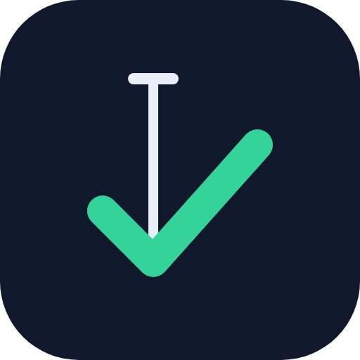
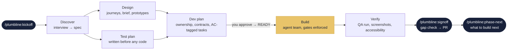
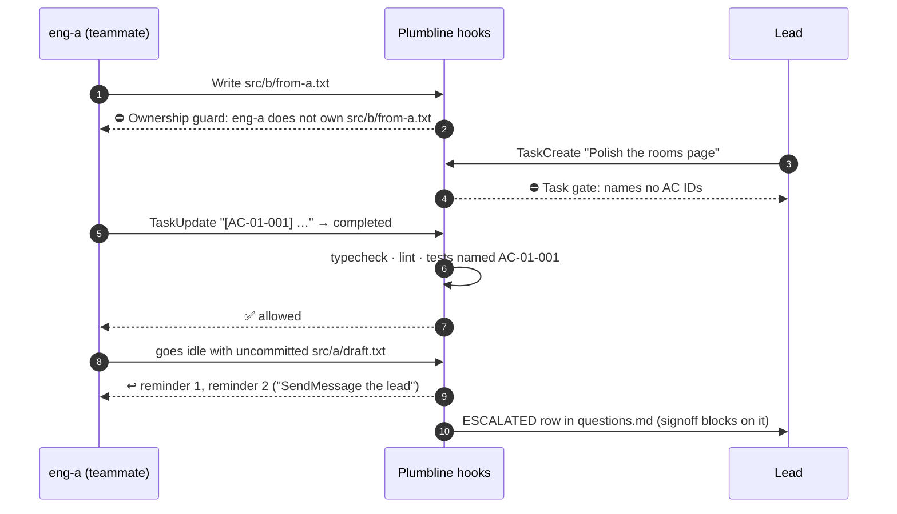
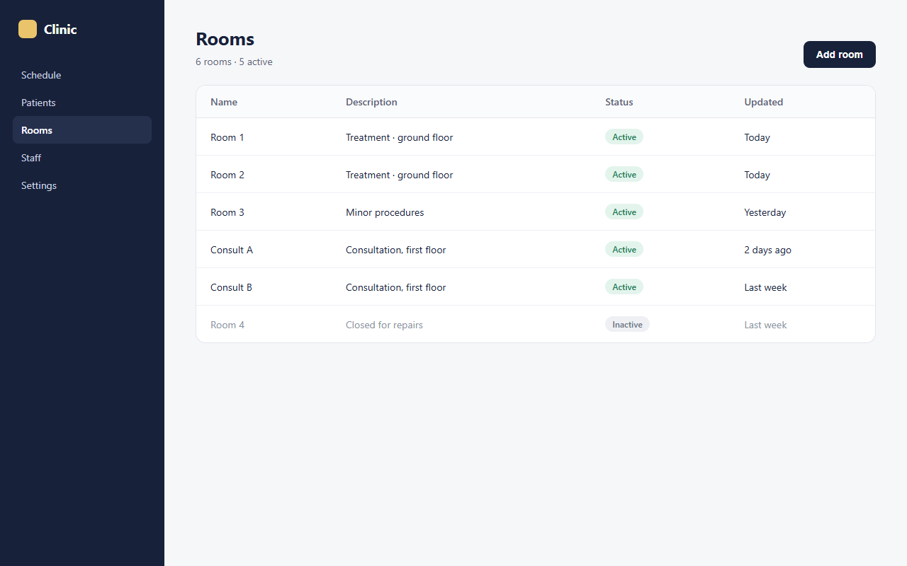
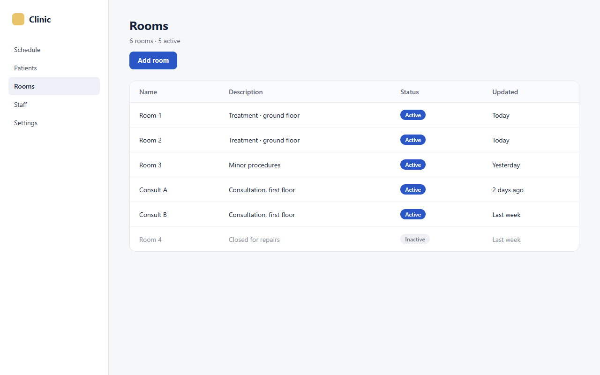
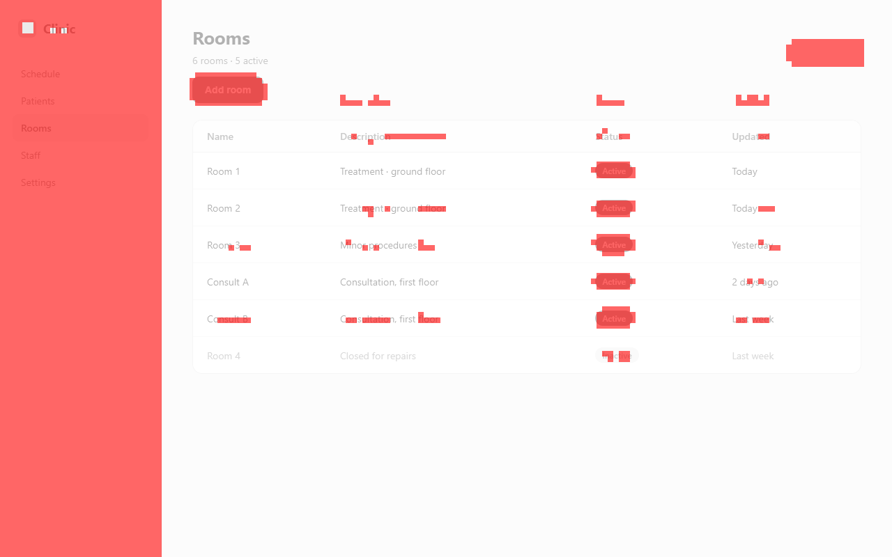

<p align="center">
  
</p>

<h1 align="center">Plumbline</h1>

<p align="center">
  <strong>Ship software feature by feature with a Claude Code agent team,<br>
  and hold every feature against its spec before it merges.</strong>
</p>

<p align="center">
  
  
  
  
  
  
</p>

<p align="center">
  <a href="#size-the-work">Quick, Standard, Full</a> ·
  <a href="#how-it-works-full">How it works</a> ·
  <a href="#the-team">The team</a> ·
  <a href="#quality-gates">Quality gates</a> ·
  <a href="#visual-and-accessibility-checks">Visual checks</a> ·
  <a href="#proof-not-promises">Proof</a> ·
  <a href="#quick-start">Quick start</a> ·
  <a href="#roadmap">Roadmap</a>
</p>

---

> A plumb line is the builder's oldest instrument: a weight on a string that shows true
> vertical, so nothing gets built crooked. **Plumbline does that for software built by AI
> agents.** Each feature is specified, designed, planned, built and verified by a small team
> of specialised Claude agents. Every step is checked against the product docs by scripts,
> not by the model's say-so.

## Why Plumbline

AI agents write code fast. Left alone, they also guess requirements, skip edge cases, edit
each other's files, delete the failing test, and declare victory. Plumbline replaces trust
with structure.

| Without a process | With Plumbline |
| --- | --- |
| "Done" means the agent says it's done | Done means typecheck, lint and **the tests named after each acceptance criterion** pass, enforced by a hook |
| Requirements live in a chat message | A spec with priorities, Non-Goals and success metrics, plus acceptance criteria with IDs (`AC-01-004`) |
| Parallel agents overwrite each other | An **Ownership table**: a teammate can only edit the files it owns |
| A failing test gets skipped under pressure | Engineers are told never to delete, skip or weaken a test, and an eval checks they don't |
| Unanswered questions become guesses | The product engineer escalates; signoff refuses to pass with an open escalation |
| The UI drifts from the design | Screenshots of the built app are compared with the prototype, and every screen gets an accessibility scan |

## Size the work

Most requests don't need ten documents and a team. Start with
**`/plumbline:build <request>`**. The product engineer reads your docs and code, picks a
size, and prints its decision before anything is created. This is an **example** of that
block (the values are illustrative, not measured):

```text
Plumbline triage
Size: Quick
Module: rooms (existing)
Folder: none
UX: no
Engineers: 1
Docs: none
Team: no
Why: one rule changes in one module; no new screen, schema or shared contract
```

| | **Quick** | **Standard** | **Full** |
| --- | --- | --- | --- |
| Fits | One module, up to 3 criteria, no new screen or flow, no schema or shared-contract change | Anything between | A module built from scratch, 3+ screens, a data migration, an auth, permissions or billing change, cross-module work, or about 10+ criteria |
| Produces | A `quick/<yymmdd>-<slug>` branch, tests named after 1-3 criteria (`AC-<yymmdd>-<nn>`), the check, a review, a PR. **No folder.** | A slim feature folder (spec, criteria, test plan, dev plan, plus `ux.md` and mockups when a screen changes) | The whole process below, with an agent team |
| People | One engineer and a reviewer | 1-2 engineers, one plan approval from you | Product, UX, QA, lead and engineers |
| Agent team | No | Only with 2 engineers and teams enabled | Yes (needs `CLAUDE_CODE_EXPERIMENTAL_AGENT_TEAMS=1`) |

**When Plumbline asks you something:** when the request is too vague for observable
criteria, when triage can't decide the size or the module, always before Full work, and
when `PLUMBLINE_CONFIRM=always`. Before
any branch or file it lists the commands it will run (git, `gh`, your tests);
Claude Code asks you to approve any it doesn't already allow. Standard also asks one
question: approve the plan, or change it. Otherwise it goes straight on.

The quality bars hold at every size: observable acceptance criteria, tests named after
them, a script check, a review, and a PR you merge. Quick runs its check
with `ac-check.sh` (typecheck, lint and the AC-named tests), because subagents aren't covered
by the task hooks.

**Only you can waive.** An agent can't write an `Evidence waived:` or
`Accessibility waived:` line: the ownership guard blocks it, for every agent and at every
size. When evidence or an accessibility scan can't be produced, the main session asks
you, and writes the line only after your explicit yes.

## How it works (Full)

This is the whole process, used for Full work or when you start it by hand with
`/plumbline:kickoff`. Standard keeps a slim version of it; Quick skips the folder.



1. **`/plumbline:kickoff <module> <feature-slug>`** (or `/plumbline:build`, for Full work) creates
   the feature's docs from templates and a branch.
2. **`/plumbline:discover`** interviews you, then drafts `spec.md` from your answers.
3. The **UX engineer** writes a design brief, journeys and screen states, and builds
   self-contained HTML prototypes. The **QA engineer** writes the test plan from the docs,
   before code exists.
4. The **lead** splits the work along file-ownership seams, lands shared contracts first,
   and writes AC-tagged tasks. **You approve the plan**, and it flips to `Status: READY`.
5. The **build** runs as an agent team. From READY on, hooks enforce ownership, task
   tagging, test gates and clean hand-offs.
6. **QA** runs the plan, compares screenshots with the prototypes and scans for
   accessibility. Product and design verify.
7. **`/plumbline:signoff`** runs a deterministic gap check and opens the PR. **You merge.**

## The team

| Role | Agent | Model | Owns |
| --- | --- | --- | --- |
| 🧭 Product engineer | `plumbline:product-engineer` | opus | *What* is built: research, spec, use cases, acceptance criteria, decisions |
| 🎨 UI/UX engineer | `plumbline:ux-engineer` | opus | *How it feels*: journeys, design brief, screens, prototypes, tokens, design principles |
| 🏗️ Lead engineer | `plumbline:lead-engineer` | opus · xhigh effort | *How* it's built: dev plan, team size, contracts, task order, review |
| 🛠️ Senior engineers | `plumbline:senior-engineer` | sonnet (opus for high-risk work) | One workstream each, test-first |
| 🔎 QA engineer | `plumbline:qa-engineer` | opus | Test plan and the verdict, independent of the code |
| ▶️ QA runner | `plumbline:qa-runner` | sonnet | Runs the plan: suites, browser journeys, screenshots, accessibility |
| 🧪 Code reviewer | `plumbline:code-reviewer` | sonnet, or opus for high-risk work | Read-only, fresh-eyes review of every workstream |

Judgement-heavy work runs on opus. Procedural work (implementing a planned task, running a
test plan) runs on sonnet.

## Quality gates

Gates are plain **bash + jq hooks**, not model judgement. They switch on once the dev
plan says `Status: READY`, so discovery and planning run freely.



The messages your agents actually see, quoted from the live team test:

| Hook | Fires on | Example |
| --- | --- | --- |
| **Ownership guard** | `PreToolUse` Edit/Write | `Ownership guard: eng-a does not own src/b/from-a.txt (owns: src/a/**). Message the owner or the lead.` |
| **Task-created gate** | `TaskCreated` | `Task gate: "Untagged task" names no AC IDs. Start the subject with the ACs it delivers, e.g. "[AC-03-004 AC-03-005] Reschedule API", or with "[chore]" for coordination work that delivers no AC.` |
| **Task-completed gate** | `TaskCompleted` | Runs typecheck, lint and `test:ac "<AC IDs>"`. Refuses with `Task gate: tests for AC-01-002 failed or none exist. Name tests after their AC IDs.` |
| **Idle gate** | `TeammateIdle` | `Idle gate: uncommitted changes in files you own: src/a/draft.txt.` The second reminder adds `If you can't fix this, SendMessage the lead now with this exact list: src/a/draft.txt`, then it escalates |
| **Phase context** | `SessionStart`, `SubagentStart` | Gives every agent its phase, ownership, brief and open questions (below) |

<details>
<summary><b>What a teammate is told at start-up</b> (real <code>context.sh</code> output)</summary>

```text
Plumbline phase: docs/product/clinic/phases/phase-01 (dev plan: READY).
Plumbline scripts: <plugin>/plugins/plumbline/scripts
You are eng-api. You own: apps/api/**
Your brief: docs/product/clinic/phases/phase-01/briefs/eng-api.md. Read it before anything else; open the full docs only when it isn't enough.
Questions in docs/product/clinic/phases/phase-01/questions.md: 1 open, 0 escalated to the user.
```

Each engineer works from a **generated brief**: its files, its tasks, only the acceptance
criteria those tasks cite, the spec's business rules and permissions, its screens and
contracts. It doesn't re-read every document, and it doesn't miss the rules.
</details>

### Signoff can't be talked past

`/plumbline:signoff` starts with `signoff-check.sh`, a script that lists every gap. This is
real output on a feature that isn't ready:

```text
$ bash scripts/signoff-check.sh
Signoff check: 10 gap(s) in docs/product/clinic/phases/phase-01:
- AC-01-004 has no passing test in test-plan.md
- AC-01-005 has no passing test in test-plan.md
- QA verdict is PENDING, not PASS (qa-report.md)
- open bug BUG-01-001 (high): Clinic B's rooms appear in clinic A's list (qa-report.md)
- no accessibility results for the 2 screen(s) in ux.md: run the scan, or add "Accessibility waived: <reason> (approved by <who>)" (qa-report.md)
- OPEN question #1: Grey out inactive rooms, or hide them? (questions.md)
- unticked sign-off box: Product verification: every journey walked (product engineer) (signoff.md)
- unticked sign-off box: Design verification: every screen checked against ux.md (UX engineer) (signoff.md)
- unticked sign-off box: Integration review complete (lead engineer) (signoff.md)
- unticked sign-off box: QA verdict PASS (QA engineer) (signoff.md)
```

And the at-a-glance view any time, with `/plumbline:status`:

```text
Phase docs/product/clinic/phases/phase-01 · dev plan: READY
ACs: 5 · with a test: 3 · without: AC-01-004 AC-01-005
Open bugs: critical 0 · high 1 · medium 0 · low 0
QA verdict: PENDING
Questions: 1 open · 0 escalated
Uncommitted files: 1 total (by owner: eng-api 1)
```

## Visual and accessibility checks

QA screenshots every key screen of the built app and compares it with the UX engineer's
prototype. Below, the plugin's own tools on a real example: the build drifted (sidebar
theme, button position, badge colour), and `visual-diff.mjs` flagged the screen for design
review at **41.8%** different, tinting every changed region.

<table>
  <tr>
    <th>Prototype (UX engineer)</th>
    <th>Built app (QA runner)</th>
    <th>Diff (<code>visual-diff.mjs</code>)</th>
  </tr>
  <tr>
    <td></td>
    <td></td>
    <td></td>
  </tr>
</table>

```text
| Screen     | Width | Different | Threshold | Result |
| rooms-list | 1280  | 41.8%     | 20%       | review |
| rooms-list | 390   | 63.8%     | 20%       | review |
```

- **`capture.mjs`** takes prototype and app screenshots the same way: 390×844 and
  1280×800, scale 1, animations off, fonts loaded. With `--a11y` it runs an
  **axe-core** scan against the WCAG 2.0–2.2 A and AA rules.
- **`visual-diff.mjs`** compares **8×8 block averages** over content, using Node
  built-ins only, with its own PNG decoder tested against real browser screenshots.
  Layout, colour and missing elements count; different text and data don't. So it
  catches structural drift, not wording; the UX engineer's walk-through covers content.
- **Accessibility gate:** signoff blocks on any serious or critical violation, and on a
  scan that never ran unless the waiver is explicit (`Accessibility waived: <reason>
  (approved by <who>)`).
- **Optional by design:** the comparison needs only Node. Screenshots and scans need
  `playwright-core` and `axe-core` in your project, and use the Chrome or Edge you
  already have, so no browser download. Without them the scripts print `SKIPPED` with
  the install command.

## Proof, not promises

Plumbline is measured with **Claude Code's plugin eval suite**: 14 realistic cases, one or
more per role and skill, graded by regex, tool-use and LLM-judge checks. The baseline is
recorded **before** any change, and a release ships only if no case drops below it.

| Eval case | v0.1.2 | v0.2 | v0.3 |
| --- | :---: | :---: | :---: |
| Senior engineer refuses to skip a failing test under deadline pressure | 0.22 | **1.00** | 1.00 |
| Product spec has Non-Goals, P0/P1/P2 priorities and success metrics | 0.25 | **1.00** | 1.00 |
| UX: design directions and a self-contained prototype | 0.92 | **1.00** | 1.00 |
| Product escalates an undecided rule instead of guessing | 1.00 | 1.00 | 1.00 |
| Lead writes a dev plan with clean ownership and AC-tagged tasks | 1.00 | 1.00 | 1.00 |
| QA test plan traces every AC, plus negative, tenant and UI-state cases | 1.00 | 1.00 | 1.00 |
| Reviewer flags a tenant-isolation leak as Critical | 1.00 | 1.00 | 1.00 |
| Engineer won't edit the shared contract; asks the lead | 1.00 | 1.00 | 1.00 |
| Signoff stops and names every gap | 1.00 | 1.00 | 1.00 |
| Kickoff creates the feature docs | 1.00 | 1.00 | 1.00 |
| **Overall (the 10 original cases)** | **0.84** | **1.00** | **1.00** |
| Product memory: a recorded decision survives a teammate's suggestion | — | 0.89 | **1.00** |
| `phase-next` proposes from evidence and asks before editing the roadmap | — | — | 1.00 |
| QA runner records scans as not run instead of inventing results | — | — | 1.00 |

Details and the honest costs of each release are in [`docs/evals/`](docs/evals).

Every release is also checked by:

- **524 self-tests** (`bash tests/run-all.sh`): 219 for the hooks, run in two Windows path modes;
  76 for the shared helpers; 121 for kickoff and the layouts; 108 for the scripts,
  including the PNG decoder against a real browser screenshot.
- **A live agent-team test** with real teammates. v0.2 passed **11/11**: ownership block,
  creation gate, `[chore]` tasks, idle escalation, injected context, status and signoff.

## Quick start

```bash
# 1. Install
claude plugin marketplace add safiullah7/plumbline
claude plugin install plumbline@plumbline --scope project

# 2. Start Claude Code (agent teams are needed only for Full-size work)
CLAUDE_CODE_EXPERIMENTAL_AGENT_TEAMS=1 claude
```

```text
# 3. Inside Claude Code: describe the work, Plumbline sizes it and runs the matching process
/plumbline:build make the double-booking check ignore cancelled bookings
```

`/plumbline:build` shows its triage block, asks only what it must, and ends with a PR
you merge. The step-by-step skills are the manual path, for when you want to drive a
Full feature yourself:

```text
/plumbline:kickoff clinic scheduling    # module form: docs from templates, a branch, the current feature
/plumbline:discover                     # interview → spec.md
…                                       # product, design, QA and the lead fill in the docs
/plumbline:status                       # where things stand
/plumbline:signoff                      # gap check → PR (you merge)
/plumbline:phase-next                   # what to build next, from evidence
```

(`/plumbline:kickoff clinic phase-01` still creates the legacy phase layout.)

**Requirements:**
- Claude Code, with agent teams for Full-size work;
- `jq`;
- Git Bash on Windows;
- for the task gate, your repo's `typecheck`, `lint` and `test:ac` npm scripts.
  `test:ac "<AC IDs separated by |>"` must fail when any ID has no passing test named
  after it. Many runners pass when a name filter matches nothing; see
  [`tests/e2e/setup.sh`](tests/e2e/setup.sh) for a node:test example.

<details>
<summary><b>All commands</b></summary>

| Command | What it does |
| --- | --- |
| `/plumbline:build <request>` | Sizes the request (Quick, Standard or Full), shows the triage, runs the matching process to a PR |
| `/plumbline:kickoff <module> <feature-slug> [--profile standard/full] [--no-ux]` | Creates the feature's docs from templates, marks it current, branches. `/plumbline:kickoff <area> phase-NN` creates the legacy layout |
| `/plumbline:discover [idea]` | Interviews you, then drafts `spec.md` from your answers |
| `/plumbline:status` | Plan status, AC test coverage, open bugs, questions, uncommitted work per owner |
| `/plumbline:handoff` | Records progress, commits the docs, prints a prompt to resume in a fresh session |
| `/plumbline:signoff` | Runs the gap check, then opens or updates the PR |
| `/plumbline:phase-next` | Proposes the next feature from evidence: missed metrics, shipped bugs, open findings, deferred scope |
</details>

<details>
<summary><b>Configuration</b></summary>

| Setting | Default | Purpose |
| --- | --- | --- |
| `PLUMBLINE_TYPECHECK` | `npm run -s typecheck` | Typecheck command for the task gate (`""` skips it) |
| `PLUMBLINE_LINT` | `npm run -s lint` | Lint command for the task gate |
| `PLUMBLINE_TEST_AC` | `npm run -s test:ac --` | Runs the tests for the given AC IDs |
| `PLUMBLINE_VISUAL_THRESHOLD` | `20` | Percent of content blocks that may differ before a screen is flagged for review |
| `PLUMBLINE_TEST_GLOBS` | `*.test.* *.spec.* …` | Which files count as tests for `/plumbline:status` coverage |
| `PLUMBLINE_CONFIRM` | `auto` | `always` makes `/plumbline:build` confirm its triage block even when it is clear |
| `PLUMBLINE_HOOK_TIMING` | off | Print how long each gate check took |
| `PLUMBLINE_HOOK_DEBUG` | off | Log every hook payload to `$TMPDIR/plumbline-hooks.jsonl` |

Set them in the `env` block of `.claude/settings.json`. For long builds,
`"subagentPromptCacheTtl": "1h"` lets teammates reuse cached prompts.
</details>

<details>
<summary><b>What a feature looks like on disk</b></summary>

Docs are organised by **module** (a product area such as `clinic`), then by feature.
Feature numbers are one sequence across the whole repo, so `AC-<nn>-<nnn>` IDs never
collide between modules.

```text
docs/product/clinic/
├── vision.md               who it's for, problem, principles, and the Features table (the roadmap)
├── design-principles.md    principles, tokens, accessibility baseline, patterns to avoid
├── decisions.md            decisions later features must respect
├── changes.md              one row per Quick change: date, request, ACs, PR
└── 01-scheduling/          <nn>-<feature-slug>/
    ├── .plumbline          metadata written by kickoff.sh: module, number, profile, ux
    ├── spec.md             goal, research, P0/P1/P2, rules, permissions, Non-Goals, metrics
    ├── acceptance-criteria.md   AC-01-001 … observable, exact, prioritised
    ├── ux.md               brief, journeys (Mermaid), screen inventory, states, critique
    ├── test-plan.md        written before the build; every case traced to an AC
    ├── dev-plan.md         team, ownership, contracts, AC-tagged tasks, Status: READY
    ├── questions.md        every question and answer; ESCALATED blocks signoff
    ├── progress.md         hand-off notes, newest first
    ├── qa-report.md        verdict, bugs, visual comparison, accessibility
    ├── signoff.md          verification, findings, success metrics results
    ├── contracts/  prototypes/  briefs/  qa/
```

A Standard feature gets the same folder with a slimmer `spec.md` and `test-plan.md`, and
no `ux.md` or `prototypes/` when no screen changes. Quick changes get no folder.

Repos from v0.3 keep working: the older `docs/product/<area>/phases/phase-NN/` layout is
still read by every script, nothing is moved, and new features in such an area go into its
`phases/` folder.
</details>

## Roadmap

| Release | Status | Highlights |
| --- | --- | --- |
| **v0.1** | ✅ shipped | The agent team, ownership and task gates, kickoff and signoff |
| **v0.1.2** | ✅ shipped | Windows path fix, visible escalations, QA ownership |
| **v0.2** | ✅ shipped | A method for every role, the creation gate, injected context, briefs, the eval suite (0.84 → 1.00) |
| **v0.3** | ✅ shipped | Visual comparison, accessibility gate, `/plumbline:phase-next`, product memory |
| **v0.4a** | 🔍 in review | **Adaptive delivery:** one `/plumbline:build <request>`; the product engineer sizes the work (Quick, Standard or Full) and the plugin picks the roles, team size and docs; docs organised by module and feature |
| **v0.4b** | 🗺️ planned | Project awareness: the plugin learns what kind of software you are building and adapts roles and evidence to it |

The full plan, with every task and its acceptance check, is in [`docs/dev-plan.md`](docs/dev-plan.md).

## Repository layout

```text
.claude-plugin/marketplace.json      marketplace entry
plugins/plumbline/
├── agents/                          seven role definitions
├── skills/                          build, kickoff, discover, status, handoff, signoff, phase-next (+ templates)
├── hooks/hooks.json                 gates and context injection
├── scripts/                         the gates and tools (bash + jq; Node for screenshots and diffs)
└── evals/                           plugin eval cases and their shared fixture
tests/                               hook and script self-tests, the live smoke test, the end-to-end benchmark
docs/                                the roadmap and eval results
```

## Contributing and testing

```bash
bash tests/run-all.sh                 # every self-test suite, one summary line each
bash tests/hooks-selftest.sh          # hook gates
bash tests/scripts-selftest.sh        # status, signoff, briefs, evidence, image diff
bash tests/kickoff-selftest.sh        # kickoff.sh in both layouts
bash tests/lib-selftest.sh            # shared helpers, ac-check
claude plugin validate ./plugins/plumbline --strict
claude plugin eval ./plugins/plumbline --scaffold --allow-tools Write Edit --ablation none --no-publish
```

The live team test is in [`tests/smoke/README.md`](tests/smoke/README.md), and the
end-to-end benchmark in [`tests/e2e/README.md`](tests/e2e/README.md).

## License

[MIT](LICENSE) © 2026 Safi Ullah
